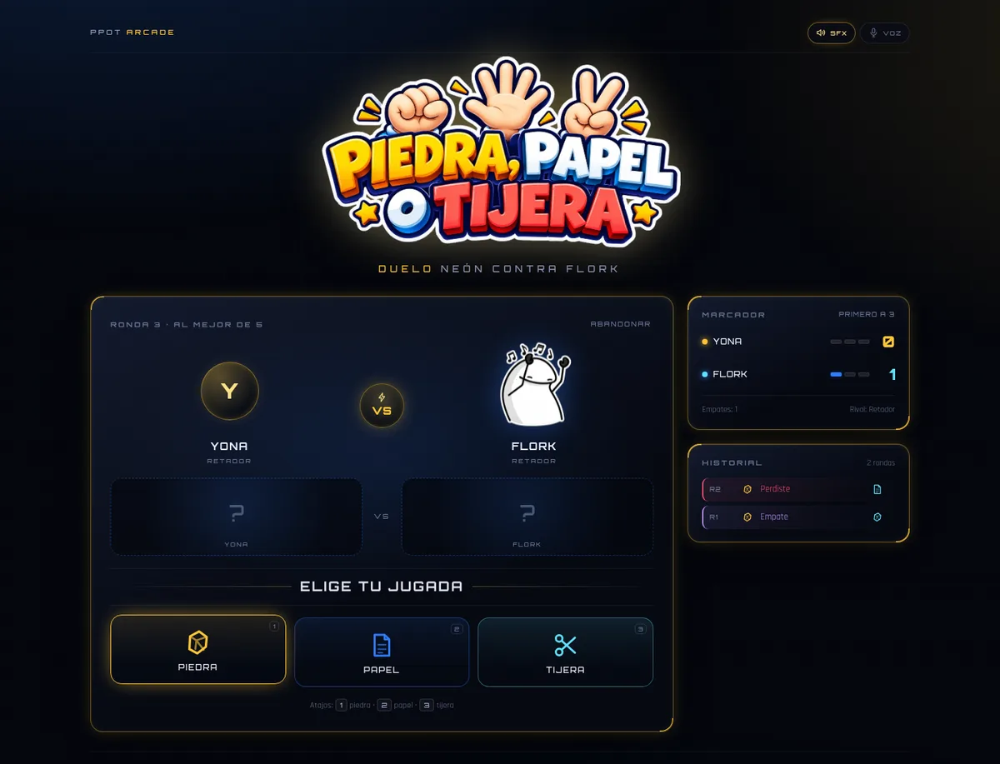
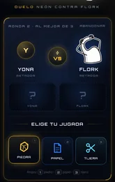

<div align="center">
  
</div>

<h1 align="center">PPoT · Duelo Neón</h1>

<p align="center">
  Piedra, papel o tijera con estética arcade: negro profundo, dorado y azul eléctrico.
  <br />
  Series, rachas, un rival que aprende tus patrones y un Flork que no perdona.
</p>



## Qué es

Un juego de **piedra, papel o tijera** contra la máquina, construido con React y Vite.
Mantiene la estructura del proyecto de referencia (`App.jsx`, `components/`, `assets/`,
`App.css`, `index.css`) y la mejora con lógica testeada, tres niveles de IA, estadísticas
persistentes, sonido sintetizado y una interfaz neón totalmente responsive.

## Jugar

<p align="center">
  <a href="https://yzakkart-ppot.vercel.app/">
    
  </a>
</p>

**O en local:**

```bash
git clone https://github.com/YonaZakkart/ppot.git
cd ppot
npm install
npm run dev
```

Abre <http://localhost:5173>.

<br clear="right" />

## Características

- **Series BO3 / BO5 / BO7** con campeón, revancha y cambio de jugador sin recargar.
- **Tres rivales con comportamiento real**
  - `Novato`: juega al azar.
  - `Retador`: contragolpea tu jugada más usada y tu última jugada.
  - `Pesadilla`: predice tu siguiente jugada a partir de tus secuencias.
- **Marcador, historial de rondas y rachas** en vivo.
- **Estadísticas persistentes** en `localStorage`: partidas, victorias, porcentaje, rachas y uso de movimientos.
- **Audio propio con WebAudio** (clic, victoria, derrota, empate, fanfarria).
- **Atajos de teclado**: `1` piedra, `2` papel, `3` tijera.

### Reglas

- Piedra vence a tijera · Papel vence a piedra · Tijera vence a papel.
- Cada ronda ganada suma un punto; los empates no suman y se registran aparte.
- Gana la serie quien llegue primero a la meta (2 en BO3, 3 en BO5, 4 en BO7).

### Controles

| Acción | Teclado | Ratón |
| --- | --- | --- |
| Jugar piedra | `1` o `P` | Botón **Piedra** |
| Jugar papel | `2` o `L` | Botón **Papel** |
| Jugar tijera | `3` o `T` | Botón **Tijera** |
| Cerrar el modal de campeón | `Escape` | **Ver el tablero** |

## Stack

- **React 19** + **Vite 8**
- CSS puro con variables de diseño (sin frameworks de UI)
- **Vitest** para la lógica del juego
- Sin dependencias de runtime más allá de React

## Scripts

| Comando | Qué hace |
| --- | --- |
| `npm run dev` | Servidor de desarrollo con HMR |
| `npm run build` | Build de producción en `dist/` |
| `npm run preview` | Sirve el build de producción |
| `npm test` | Ejecuta los tests una vez |
| `npm run test:watch` | Tests en modo watch |

## Estructura

```
.
├── public/
│   ├── favicon.svg
│   └── icons.svg
├── src/
│   ├── assets/            # título y florks en WebP
│   ├── components/
│   │   ├── ArenaDuelo.jsx
│   │   ├── CantoDuelo.jsx
│   │   ├── FormularioJugador.jsx
│   │   ├── HistorialRondas.jsx
│   │   ├── Icono.jsx
│   │   ├── ModalCampeon.jsx
│   │   └── TablaMarcador.jsx
│   ├── game/
│   │   ├── almacenamiento.js
│   │   ├── estadisticas.js
│   │   ├── motor.js
│   │   ├── movimientos.js
│   │   └── rival.js
│   ├── App.css
│   ├── App.jsx
│   ├── index.css
│   ├── main.jsx
│   └── sonido.js
├── index.html
├── package.json
└── vite.config.js
```

La lógica vive separada de la interfaz en `src/game/`:

- `motor.js`: funciones puras e inmutables para crear partidas, resolver rondas y coronar campeones.
- `rival.js`: estrategias de la IA con generador de azar inyectable (tests deterministas).
- `estadisticas.js`: acumulados y derivados (porcentaje de victorias, movimiento favorito).
- `almacenamiento.js`: persistencia versionada tolerante a fallos.

## Tests

```bash
npm test
```

25 tests cubren las 9 combinaciones de jugadas, series y campeones, rachas, las tres
dificultades, el cálculo de estadísticas y la degradación segura del almacenamiento.

## Assets

Los assets originales (título 3D y los tres Flork) fueron proporcionados en las sesiones
de clases y se optimizaron a WebP (de ~4.5 MB a ~260 KB) dentro de `src/assets/`.

Los assets se incluyen únicamente con fines de demostración del proyecto.
